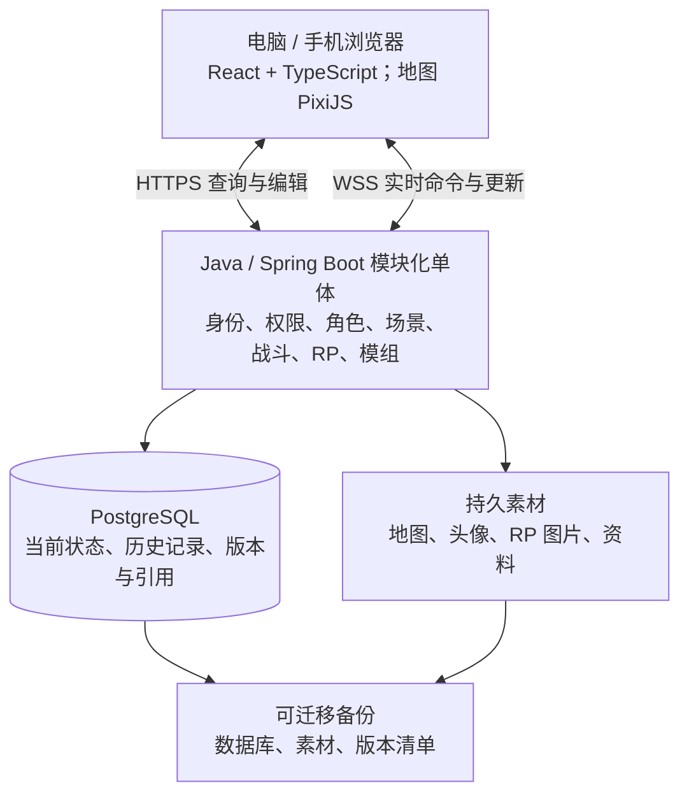

# 线上 D&D 虚拟桌面设计方案 v0.2

日期：2026-10-18。状态：产品设计基线。2026-10-18 用户已授权进入实现，实施阶段和测试状态见 [实施路线](implementation-plan.md)。

本次修订：按用户与同伴的最新决定，规则基线统一切换为 5R（2024 修订版）+ DM 选用的扩展规则，替代原先以 2014 为基础的方案。

## 1. 目标与设计依据

为固定伙伴提供可以长期保存进度的网页跑团桌面：DM 主持、玩家操作各自角色，地图与回合同步，文字 RP 可检索留存。电脑提供完整体验，手机支持角色卡、资源、掷骰与日志。语音继续使用现有工具。

首版采用 DM 手动裁定、半自动角色卡；基础数值计算、快捷投掷、战斗开始时的自动先攻属于明确的辅助自动化。攻击自动判定、扣血与效果执行在第二阶段加入，并默认先交 DM 确认。

默认核心机制、角色字段、状态定义和自动化判定按 5R（2024 修订版）设计。扩展逐项记录来源与适用版本，由 DM 决定是否启用；旧版扩展保留接入口，不自动视为与新版兼容。

用户的逐项选择记录于 [决策地图](design-map.md) 及对应子票。本稿中的具体界面布局、消息字段、接口划分、导入校验和验收方法为基于这些选择提出的工程设计建议，可在整体审阅中修改。

## 2. 阶段边界

| 阶段 | 能力 |
| --- | --- |
| 第一阶段：完整跑团 | 账号与邀请、二维地图、手动遮盖、单位隐藏、一人多角与共享控制、完整半自动角色卡、规则检索与填卡、投骰、自动初始先攻、角色级回合、状态计时提醒、引导攻击与手动应用结果、可展开日志、RP 文字/图片/引用、保存与备份恢复 |
| 第二阶段：模组与自动化 | 模组制作、定制副本、导入导出、选择性更新、DM 一键触发；明确支持范围内的攻击结算、效果与资源联动；移动路径、预算和范围提示 |
| 后续增强 | 自动视野、分队地图、条件剧情触发、文档辅助转换；本机穿透与 P2P 单独验证 |

第一阶段可手动创建场景、上传地图并配置单位，不依赖完整模组编辑器。首版不包含公开找团大厅、QQ 对接、旧 QQ 日志导入、玩家私人笔记、内置语音、录音转写或完整自动建卡器。未来补充需求按版本迭代，不静默扩大当前范围。

## 3. 账号、角色与权限

固定账号登录，使用 DM 邀请加入战役。战役成员关系与系统管理权限分别管理；主持某个战役不自动取得其他战役的数据。

- 同一玩家可以创建并控制至少两个独立角色，不设账号与角色的一对一关系。各角色独立保存角色卡、生命、资源和先攻位置。
- DM 可以把一个单位授权给多名玩家并收回授权。每次修改、移动、发言和投骰记录实际操作者。
- 玩家可直接编辑自己的角色卡并留痕，DM 可查看和纠正。
- 战役提供“内容需要批准 / 自由选用”开关。切回批准模式保留已有配置，仅对新增或替换内容审批，另提供现有配置检查入口。
- 内容准入、角色卡编辑、棋子控制和资料可见性是独立权限，不共用一个“开放模式”。
- 自由选用开关只放宽内容审批，不将战役核心机制切回 2014，也不等于软件已经支持所有扩展规则自动执行。

| 对象 | 默认可见性 |
| --- | --- |
| 自己的角色卡 | 控制者与 DM 查看完整资料 |
| 队友角色卡 | 展示战斗摘要；可按角色共享完整卡 |
| 敌方单位 | 名称、头像、DM 允许的状态与生命概况；精确生命及完整资料仅 DM |
| 隐藏单位、机关 | 仅 DM，直到 DM 明确公开 |
| 团队笔记 | 战役成员共享 |
| DM 备团资料、暗骰 | 仅 DM |

可见性由后端裁剪，不将完整隐藏内容发送给客户端再依靠界面遮挡。角色卡查询、地图、聊天引用、搜索、导出、图片下载与 WebSocket 推送适用同一权限边界。

## 4. 界面与操作入口

推荐电脑布局：中央地图；顶部回合顺序；左侧场景与单位列表；右侧可收起的角色卡/资料；底部或侧栏为文字时间线与输入框。日志和资料支持展开，地图不被常驻大面板挤占。

选择棋子后显示对应单位、生命与状态、常用投掷和攻击。文字输入框明确显示当前发言角色，切换角色同时更新角色检定的默认对象，避免一人多角时用错数值。

手机使用单列页面和标签切换，首版重点为角色卡、资源加减、掷骰、RP 与日志；不承诺完整触屏地图编辑及主持能力。

## 5. 地图、棋子与场景

首版上传二维图片，配置方格大小、偏移和每格距离。支持缩放、平移、吸附、测距及选中单位。首版全团共用 DM 指定的当前场景，切换时保存其他场景的棋子和遮盖状态。

角色的长期资料与棋子的地图表示分开。复制一个角色可以创建独立角色；移动或重新放置棋子不会创建新的生命值与资源。后续跨地图放置同一角色时，仍引用同一角色身份，不能意外生成多套资源。

探索时自由移动已授权棋子；战斗时按当前行动单位限制移动，DM 可以放行或直接调整。拖动时先本地预览，提交后以后端接受的位置为准。首版显示距离，由 DM 裁定复杂移动。

DM 手动揭露或遮盖地图，全队共享已揭露区域；单位隐藏独立管理，揭露区域不会自动公开隐藏单位。自动视野加入后仍保留 DM 手动遮盖与单位隐藏，自动计算不能覆盖 DM 主动隐藏。

地图资源设计建议：DM 原图、秘密标注与玩家可获取的素材分开。若未知区域本身需要严格保密，按揭露结果提供缓存切片或裁剪结果，不向玩家开放 DM 原图下载。已经公开并下载的内容不能通过再次遮盖撤回。

未来移动预算基于路径与本回合已用距离，不能只比较起点终点。预留移动方式、预算调整、规则配置和 DM 覆盖记录；具体距离算法与例外在自动化实现前按所用版本查证。

## 6. 半自动角色卡

| 分组 | 首版字段与操作 |
| --- | --- |
| 基本资料 | 名称、头像、物种（种族）、背景、职业、子职、等级、来源与版本 |
| 属性与检定 | 六项属性、技能、豁免、熟练情况、数值来源和快捷投掷 |
| 战斗数据 | 护甲等级、生命值、临时生命值、速度、先攻、死亡豁免记录 |
| 攻击与施法 | 攻击条目、命中与伤害骰式、所选武器精通及能力来源、法术列表、施法相关数值 |
| 能力与资源 | 专长（含起源专长）、能力说明、选择与来源、使用次数、法术位、自定义计数器 |
| 装备与物品 | 装备、物品、数量、金钱、说明 |

支持手动建卡、复制和本软件结构化格式导入导出。跨战役导入重新指定角色归属并检查目标战役准入，不携带原战役的权限。第三方角色卡识别后置。

基础计算值保存组成与来源，界面可查看；DM 可覆盖并注明原因。玩家编辑自己的卡，修改历史保留。升级时先修改等级与相关选择，已支持的基础计算更新，其余能力与资源手动维护；首版不自动生成整个升级流程。

背景应能关联所选属性提升、起源专长、熟练和装备，物种特质与职业/专长来源分别记录。武器精通记录角色实际取得的选择，不默认赋予所有角色；首版提供填写与检索入口，相关自动效果留待后续。新版类别的核验见 [5R 规则基线核验](research/initiative-2024.md)。

资源使用快捷加减、消耗与恢复按钮，掷骰本身不隐式扣除。状态实例记录名称、图标、说明、来源及可选持续时间；到期提醒 DM 确认移除。状态倒计时不等同于已支持该状态的全部规则效果。

## 7. 规则检索与便捷填卡

规则检索是首版核心功能，不以手动填写作为已有内容的唯一入口。默认检索与选用基线为 5R（2024 修订版），扩展或自定义内容按 DM 配置呈现。旧版条目作为明确标注的兼容内容，不能静默替代新版同名条目。

流程：从角色卡分组打开搜索 → 按名称/关键词查找 → 筛选类型、来源、版本及本团准入 → 查看详情和支持程度 → 预览后加入。

- 同名不同版本分别呈现，加入时保留来源、版本与本团定制。
- 规则体系与来源出版年份分别记录，不能把“5R”简单等同于“书名含 2024”；修订体系内不同年份出版的资料仍按各自来源标识。
- 结构化条目可填入对应字段。仅有文字资料时可先加入说明，再补充骰式与资源等字段。
- 显示支持程度：仅说明、可快捷投骰、支持自动结算；不将“搜得到”误表示为“已经能自动执行”。
- 尚未收录的能力和数值仍可直接填写，并保存为可复制的自定义条目。
- 资料更新提示 DM 选择采用，不静默改写已有角色和历史结算。

现有全文索引提供来源、标题、章节、路径及搜索经验，尚需产品适配与结构化整理。首版线上不强制依赖向量模型、常驻 Python 服务或外部 AI。

内容接入遵循工作区已有边界：dnd_index 的商业书整合正文只供持有者本机查询，不能直接打包为共享云端资料库；云端使用允许共享的开放来源或本团有权接入的数据。源库覆盖率、结构化填卡覆盖率和自动结算覆盖率分别统计。参见 [规则全文索引说明](local-sources.md) 与 [SRD 检索说明](local-sources.md)。

## 8. 掷骰、先攻与战斗流程

所有骰子结果由服务端产生、保存并发布；按钮和文字指令进入同一套权限与行动处理逻辑。记录骰式、每颗骰子、取舍、修正值与来源快照，不信任客户端上传的最终点数。

开始战斗：DM 选择参战单位，确认先攻分组、突袭及其他已配置修正 → 系统按 5R 先攻配置自动投掷并生成候选顺序 → 检查并确认平手次序 → 开始第一回合。后续轮次沿用顺序；重掷或加入新单位均作为明确操作留痕。一人多角按各自角色参加，隐藏参战单位不得从玩家先攻列表、占位空档或日志泄露。

按已核验的 5R 规则，突袭会使先攻检定具有劣势，投掷前需显式标记并记录来源。相同怪物组与平手处理保留确认入口，不仅凭相同名称自动合并；玩家角色之间平手允许玩家决定，DM 界面保存确认后的次序。专长等额外先攻修正或顺序调整保留来源化配置与手动处理，首版不承诺全自动支持所有特性。当前依据见 [5R 先攻与角色卡类别核验](research/initiative-2024.md)；[2014 先攻核对](research/initiative-2014.md)仅留作历史对照。

首版攻击：选择攻击与目标 → 掷骰 → DM 标记命中与否 → 按需掷伤害 → 应用变化。目标、投掷、裁定和结果关联同一行动，手动裁定明确标注，不能伪装为自动计算。

当前角色控制者可以结束回合；DM 可跳过、调整顺序、切换行动单位，不设强制倒计时。首版通过 DM 放行处理回合外的移动，回合外投掷和裁定仍可记录；不能将“限制移动”扩展为封禁所有回合外操作。

第二阶段自动结算：声明行动 → 收集规则与数值快照 → 计算候选结果与解释 → DM 确认 → 一次应用数值/资源/状态 → 发布按权限裁剪的记录。DM 可开启公开行动自动应用；暗骰始终先交 DM，应用结果与公开细节是独立选择。

未支持的规则进入人工裁定，不静默按另一版本执行。自动化以 5R 为基线逐项标明适用内容、扩展版本和例外，先覆盖明确行动，不承诺所有扩展都可自动处理。状态定义和持续时间提示也采用当前版本，不沿用旧版同名状态的数值解释。

## 9. 战斗详情与更正

摘要适合快速阅读，展开后显示行动者、目标、骰子、修正来源、判断依据、状态前后值，以及 DM 覆盖或更正原因。保存结算当时的版本与数据，后续角色改名、升级或模板更新不会改变旧记录的解释。

错误通过关联原操作的更正修复，原历史保留。不采用回退整场游戏来覆盖其他人后续操作。玩家仍可编辑自己的角色卡并留痕，跨单位的战斗纠正由 DM 处理。

暗骰只向 DM 提供发起及完整结果查看。对玩家公开的摘要和展开详情均过滤隐藏骰值、敌人秘密资料和 DM 备注；引用消息、导出和附件访问使用相同规则。

## 10. 团内文字频道与机器人能力

首版内置文字频道代替 QQ 群中的文字跑团操作，不连接 QQ，也不导入旧 QQ 历史；语音沿用现有工具。

同一战役时间线容纳 RP、场外交流、公开骰子和战斗摘要，支持分类筛选。推荐以跑团场次归档，同时支持跨场次搜索，场次归档不删除或截断历史。

- 支持文字、图片和引用回复，区分角色发言与场外交流。
- 一人多角可切换发言身份，DM 可扮演 NPC。保存实际账号、角色身份及发送时的显示名称快照；后来角色改名不改变旧记录的身份解释。
- 消息可更正并保留历史版本。公共界面可显示编辑标记，不能通过改写 RP 文本修改关联骰子结果或战斗结算。
- 图片附件作为持久素材保存，不能依靠临时聊天平台地址；只要仍被历史或保留的备份引用，就不能因临时文件清理而删除。
- 提供全文搜索、分页加载、按角色/时间/场次筛选，导出可读文本或 Markdown；结构化归档用于备份和后续数据处理。导出包含相应图片附件清单。
- 普通成员只能导出自己有权查看的公开记录；DM 可导出包含其私密资料的战役完整归档。公开记录不混入暗骰原文和隐藏单位详情。

首版机器人能力：表达式投骰、角色卡快捷检定、攻击与伤害投掷、发言/投骰角色切换、开始战斗时自动先攻、记录保存搜索导出。文字命令与按钮共用行动逻辑，不另维护一套骰子和角色数值。具体命令名称在交互实现时确定，不承诺兼容旧 QQ 机器人的全部语法。

RP 历史、掷骰、战斗日志与更正关系长期保留，不设置自动过期；备份保留最近 7 份仅控制备份文件数量。未来新增机器人功能按需求迭代，不需要为了扩展命令重写记录格式。

## 11. 模组模板与定制生命周期

模组包可包含章节、场景、地图、单位模板、预摆棋子、遭遇、DM 资料、玩家可公开资料、道具奖励与规则依赖。各部分允许为空。地图素材、规则依赖和叙事内容分别标识。

新模组默认声明 5R（2024 修订版）为目标体系，并逐项声明扩展包版本及兼容说明。导入旧版模组时由 DM 明确决定是否适配，不自动改写核心机制或假定同名条目等价。

流程：导入模板库 → 创建可编辑定制副本 → DM 修改 → 创建独立战役。模板原件、定制副本和战役进行中的状态分别保存；同一模板可开多个团，彼此不共享生命值和进度。

DM 可修改地图、单位、剧情、规则配置、遭遇及触发操作组合，并将定制版本另存模板导出。首个模组阶段由 DM 点击触发揭露单位、展示资料、开始遭遇等操作；条件触发后续加入，届时条件、动作和确认方式也允许 DM 修改。

推荐交换格式为带清单的压缩包，清单描述格式版本、模组身份与版本、规则依赖和素材校验值；内容文件描述场景、单位、遭遇、资料及触发配置。以稳定内容身份建立引用，不将机器本地绝对路径当作素材身份。

导入建议：先校验格式、引用、资源与依赖，再展示预览；缺失条目标记可补充或暂不可执行。不得将缺失内容默默换成同名的另一规则版本。相同模组同版本默认识别为已存在，DM 可明确选择创建独立副本；导入失败不留下半个可玩的战役。首个模组阶段不执行包内任意程序代码。

更新采用原始基线、当前定制版本、新模板版本的差异比较。未修改部分可供批量选择，冲突逐项决定保留哪份；进行中的生命、回合、RP 和战斗记录不属于模板覆盖范围。删除已有进行中场景或替换参战单位须明确展示影响，先保留可恢复副本。更新不会重算过去的骰子与结算。

## 12. 技术架构与版本基线

采用前后端分离的网页应用，后端为一个可部署的模块化单体。模块边界为身份/成员、战役/场景、角色/内容、行动/战斗、文字/日志、素材/模组、保存/备份。用户已在 PostgreSQL 与 MySQL 比较后明确选择 PostgreSQL。首版一套 Java 进程、一套 PostgreSQL 和素材目录即可。

| 组件 | 研究建议基线 |
| --- | --- |
| JDK | Temurin 25 LTS，已核实构建 25.0.4.1+1 |
| Spring Boot | 4.1.1，Spring 组件跟随其依赖管理 |
| PostgreSQL | 18.6 |
| React / React DOM | 19.3.0 |
| TypeScript | 5.9.3，刻意选择的简化类型配置基线 |
| Vite | 8.3.4 |
| Node.js | 24.22.0 LTS，仅开发与构建使用 |
| PixiJS | 8.22.0 |

来源、兼容条件和选择理由见 [技术版本调查](research/stack-versions.md)。这些是本次核实的正式版本，不代表永久冻结；实施时锁定依赖与镜像，再完成构建联调。未实施的第三方库不在此冒列已验证版本。

前端采用 Vite 的 React/TypeScript 单页结构。React 管界面与表单，原生 PixiJS 封装为地图组件，管理高频拖动和动画。生产前端为静态资源，不另建 Node 业务服务；首版不引入额外地图 React renderer、微服务、Redis 或消息队列作为必需项。

HTTP 负责登录、资料查询编辑、搜索、素材上传、导入导出和备份；WebSocket 建议采用 Spring STOMP 路由承载实时命令与推送。通用房间广播只承载全体可见内容，角色差异和 DM 私密内容按已认证用户分别发送。传输路由不替代业务权限检查。

## 13. 核心数据关系

此处是领域模型建议，不是最终数据库建表代码。

| 对象 | 保存的主要信息 |
| --- | --- |
| 用户、成员关系 | 固定身份、战役角色、加入状态与授权 |
| 战役 | 5R 核心规则基线、扩展依赖与兼容配置、准入模式、当前场景、内容版本、长期进度 |
| 角色/单位 | 独立身份、角色卡、资源、状态、内容引用与控制关系 |
| 场景 | 底图、网格、遮盖、场景单位和资料 |
| 棋子 | 所属场景、引用单位、位置、尺寸、外观与可见性 |
| 战斗与参战者 | 参与单位、先攻结果与分组、顺序、轮次、当前行动者 |
| 行动、投骰、结算 | 请求身份、行动与目标、骰子、来源快照、裁定、待确认/已应用结果 |
| 时间线与消息 | 排序序号、实际作者、发言身份、RP/OOC/骰子/战斗分类、可见性、引用和编辑版本 |
| 更正记录 | 原操作、修复变化、原因、操作者 |
| 内容包与条目 | 稳定身份、来源、规则版本、结构化字段、说明和执行支持程度 |
| 模组、定制副本 | 发布版本、编辑基线、配置内容、依赖和差异 |
| 素材 | 文件身份、校验值、类型、归属、引用和访问权限 |
| 备份清单 | 应用/格式版本、备份时点、数据库归档与素材集合 |

关键约束：角色与账号非一对一；单位控制关系可多对多；棋子位置与角色资源分离；参战条目引用单位，不能因两个棋子表示同一单位而重复消耗资源；历史使用当时的来源快照，当前状态引用可升级的版本。

## 14. 同步、持久化与扩展边界

每个改变状态的命令包含请求身份、战役、目标对象、所期望的对象版本及操作参数。实际账号来自登录身份，不信任客户端自报的操作者、骰子结果或授权。

后端流程为校验身份与权限 → 检查对象状态/版本 → 计算或校验操作 → 事务保存状态及历史 → 返回确认并推送。投骰结果、应用结果与对应记录的持久化应保证一致。相同请求重试返回已有结果，不重复投骰、扣血或消耗资源。

单团关键战斗与地图操作顺序处理；消息追加使用幂等身份与有序序号，不因一条 RP 消息让角色编辑产生无关版本冲突。后端失败时返回可理解的拒绝原因，客户端恢复服务器确认的位置或数值。

断线重连获取当前快照与自己可见的增量记录，缺失过多则重新加载。推送中断不能成为状态丢失的理由，已经保存但尚未送达的结果可查询恢复。客户端显示发送中/已确认/失败，避免把本地预览当作保存成功。

预留边界：规则计算器返回结果和解释，不直接操纵页面；资料库、模组、当前角色与历史快照分层；动作声明、结算预览、确认应用与更正分别建模；素材存储、本机/云端部署入口与传输适配不嵌入游戏规则。只为已知扩展留接口，不先建设插件市场或分布式系统。

## 15. 保存、备份、迁移与资源

每次已确认状态变化及时保存，关机前停止接受新操作并等待进行中操作完成。重启恢复已确认位置、角色、回合、文字记录和待确认结算，不能重新掷骰或重复应用。

每日自动备份，默认保留最近 7 份自动备份；支持手动生成、下载、恢复，迁移前生成完整备份。手动导出的备份由用户保管。备份任务及失败状态在管理界面可查；这属于待开发软件功能，当前没有创建外部定时任务。

完整部署备份包括数据库逻辑归档、所有被引用的素材及 RP 图片、版本清单和恢复所需配置说明；模组导出与战役归档不是整个部署的替代。备份轮换不得删除数据库历史或仍被历史引用的素材。存放在运行主机之外的备份才能应对主机回收，因此提供一键下载并在迁移前检查备份。

为使数据库与素材一致，生成迁移包时短暂暂停新写入、等待进行中的操作完成，再生成归档和素材清单；素材采用不可变身份。恢复时验证版本、引用和文件完整性。新旧主机不同时接受同一战役写入，避免出现两份不可直接合并的进度。迁移后可以要求重新登录，不承诺保活旧连接。

推荐统一 Docker Compose 部署方式：云端与 DM 本机运行同一应用、数据库和素材服务。迁移使用逻辑备份恢复，优先保持相同数据库主版本。本机运行后仍需另行配置可达入口，不能把恢复存档等同于已解决外网联机。

单团初估为 2 vCPU、4GB 内存、40–80GB SSD；2 vCPU/2GB 可试运行但余量较小。不需要 GPU。假设约 1 名 DM 加 4–8 玩家，无内置音视频、AI 或服务端实时自动视野。地图切片生成、图片处理与备份峰值需实测；RP 图片和历史备份使存储随时间增长。

带宽按地图大小、人数及加载目标估算，初步可看 5–10Mbps 上行，配合压缩、缓存和预加载。该区间不是性能保证。DM 本机若同时运行浏览器、通话和容器，16GB 整机内存是舒适规划建议。依据和估算边界见 [保存迁移与容量](research/persistence-and-sizing.md)。

首版采用服务器；穿透与 P2P 只作为后续方向。优先验证 DM 本机运行同一后端，再接穿透或虚拟组网。P2P、穿透与素材缓存是不同机制，降低云主机费用不自动降低 DM 上传量。详见 [联机拓扑研究](research/network-topology.md)。

## 16. 验收场景

以下是设计验收建议，不表示已经实现或测试通过。

1. DM 邀请两名玩家；一名玩家创建两个独立角色，另一名被授权代管其中一个。验证各角色资源独立、共享授权可撤销、操作作者可追踪。
2. 上传地图、校准方格、放置玩家与隐藏敌人，揭露一片区域。玩家可测距移动，但不能通过列表、图片原件接口、消息引用或日志获取隐藏资料。
3. 默认搜索 5R 条目并查看来源与适用版本，再添加一项未收录扩展能力。自由/审批模式切换保留已有配置；旧版同名内容不自动替换新版，未确认的兼容或自动化有明确提示。
4. 两名玩家用不同角色发布 RP、图片和引用回复，同时用按钮及命令投骰。重连后消息不重复，角色身份与时间顺序可恢复，历史可搜索和导出。
5. DM 选择参战单位、先攻分组及突袭标记，按 5R 处理首次先攻并可展开劣势与修正来源；平手可确认调整，第二轮保持，隐藏单位不会从玩家列表泄露。
6. 完成一次手动引导攻击和一次错误结算更正。展开日志能看投骰与裁定依据，原记录保留，普通玩家无法修改敌方状态。
7. DM 暗骰后仅公开摘要或应用结果，玩家无法展开隐藏骰值；角色改名或更新资料后，旧记录仍按当时来源解释。
8. 设置状态持续时间，到期只提醒 DM；资源不因快捷试投而隐式消耗。
9. 在有待确认结算和未结束战斗时正常关机，再恢复。先攻、回合、生命、RP 图片、消息编辑历史和待确认结果保持，已确认骰子不重投。
10. 导出完整备份，在另一台主机恢复，关闭旧主机写入。账号归属、场景、遮盖、所有 RP 与战斗记录可继续使用；轮换自动备份不减少历史记录数量。
11. 第二阶段用同一模组开两个团，只改一个定制副本；验证另一个团不受影响。应用模板更新不覆盖进行中状态，缺失依赖有可操作提示。
12. 第二阶段执行一个明确受支持的自动攻击。预览、解释、DM 确认、数值/资源/效果变化和日志一致；重试不会重复执行，不支持的能力进入人工裁定。

## 17. 开发前后如何继续

本方案整体审阅后，可拆为第一阶段实现任务。基础数值公式、条目字段、先攻例外、移动规则和效果支持矩阵，应在对应实现任务中以 5R 核心及所选扩展的明确版本逐项核对；不再用 2014 研究结果充当新版规则依据，不把未来的细节实现选择伪装成本次已经验证的事实。

开始实现前固定依赖与构建环境；完成一个“账号 → 场景 → 两客户端移动 → 持久化与重连”的纵向切片后，再接角色卡、掷骰与文字记录。之后依上述验收流程开一次完整测试团，测量内存、地图加载与备份恢复，再决定是否调整容量。

后续新增需求写明影响阶段、数据迁移和旧记录兼容性，保持本方案与决策记录同步更新。2026-10-18 用户已明确授权开始编码，按整体框架、TDD、业务实现与阶段验收推进；具体进度以应用仓库实施路线及验收记录为准。

## 附录 A：数据库与本地文件如何配合

用户已明确选择 PostgreSQL，以下细化该存储方案：PostgreSQL 保存结构化状态与历史，本机目录保存二进制素材；数据库和素材目录都可以部署在云服务器或 DM 电脑，不要求购买托管云数据库。初始版本基线为 18.6，实施前复核补丁与联调。

| 数据 | 推荐位置与形式 |
| --- | --- |
| 账号、成员、战役、角色、棋子、资源与回合 | PostgreSQL 普通关系表，明确关联和对象版本 |
| RP、引用、编辑历史、骰子、行动与更正 | PostgreSQL 独立记录，按战役、序号、时间和对象组织检索；不将整个历史作为一个大 JSON 保存 |
| 自定义能力、模组配置、规则来源及结算解释快照 | 固定关系字段加按条目划分的 JSONB；常用筛选字段独立存储 |
| 地图、头像、RP 图片与资料附件 | 运行主机的持久目录，数据库保存素材身份、相对存储键、校验值、权限与引用 |
| 可交换模组、角色卡与备份 | 有版本清单的导出文件；它们用于交换或恢复，不承担在线多人共同编辑的主存储 |
| 浏览器 | 界面偏好及可重新获取的缓存，不能作为 RP 或战役唯一存档 |

PostgreSQL 提供 JSONB 及其索引能力，适合在明确关系模型中保存可扩展的小型配置，而不是把一场战役塞入一个无边界文档。[官方 JSON 类型说明](https://www.postgresql.org/docs/18/datatype-json.html)

素材使用稳定存储键，避免写入云服务器或 Windows 机器的绝对路径。先完成文件写入和校验，再保存有效引用；备份配套数据库快照和素材清单，不能只备份数据库却漏掉 RP 图片。后续可用素材存储适配层接对象存储，保持角色、消息和战役引用不变。

SQLite 是可行的轻量备选：数据库可由同机 Java 服务访问，玩家仍通过网络应用交互；多人在线本身并不排除 SQLite。它同一时刻只允许一个写者，其他写入需要排队，部署简单且省去独立数据库进程。[SQLite 适用场景](https://www.sqlite.org/whentouse.html)

本项目确定统一 PostgreSQL，结合既定服务器架构、长期 RP 关联检索、状态与历史事务及未来多人写入扩展。用户对两者经验相近，已有 PostgreSQL 系相关使用经验。云端迁移到 DM 电脑时继续运行同一数据库，不必转换引擎。首版不并行支持 PostgreSQL、MySQL 和 SQLite 多套业务存储；若以后便携版优先级提高，再单独验证 SQLite 方案。
